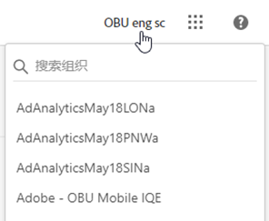
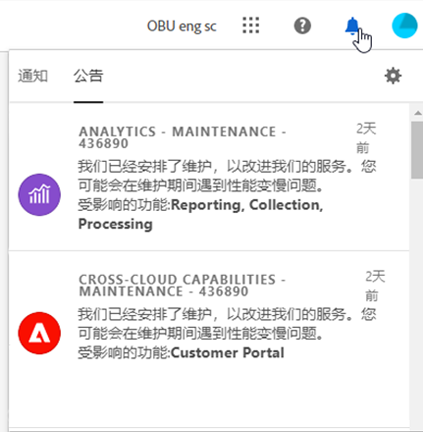
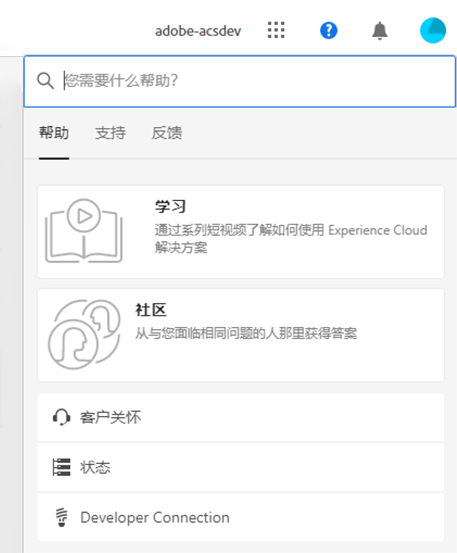

# 开始使用CX Enterprise {#get-started}

登录到[Adobe CX Enterprise](https://experience.adobe.com)以启动您的应用程序，然后使用统一标头管理您的个人资料、检查通知并查找帮助，所有这些操作都在一个位置完成。

## 开始之前 {#before-you-begin}

您需要一个已针对贵组织的CX Enterprise产品配置的Adobe ID。 如果您无法登录或看不到所需的应用程序，请与[!UICONTROL CX Enterprise] [管理员](administration/admin-console.md)联系。

## 登录到CX Enterprise {#sign-in}

登录并验证您是否处于正确的[组织](administration/organizations.md)中。

1. 导航到[Adobe CX Enterprise](https://experience.adobe.com)。
1. 键入您的Adobe电子邮件地址，然后单击&#x200B;**[!UICONTROL 继续]**。
1. 单击帐户。
1. 键入您的密码。
1. 验证您是否处于正确的组织中。

   

   **验证您的组织**

   [组织](administration/organizations.md) 显示在界面标头中。

   如果您的组织使用Federated ID，则CX Enterprise允许您使用组织的单点登录进行登录，而无需输入您的电子邮件地址和密码。 将`#/sso:@domain`添加到CX Enterprise URL (`https://experience.adobe.com`)以完成此任务。

   例如，对于带 Federated ID 和域 `example.com` 的组织，请将 URL 链接设置为 `https://experience.adobe.com/#/sso:@example.com`。 您还可以通过为追加了应用程序路径的此 URL 添加书签，直接转到特定应用程序。 （例如，对于 Adobe Analytics，使用 `https://experience.adobe.com/#/sso:@example.com/analytics`。）

   **注意：**&#x200B;贵组织的管理员可能会通过IP地址限制对Adobe产品的访问。 如果出现这种情况，在登录CX Enterprise或切换到启用了此功能的组织后，您可能会收到错误。 [按IP地址限制产品访问](https://helpx.adobe.com/cn/enterprise/using/ip-based-access.html)中提供了详细信息。

## 访问CX Enterprise应用程序 {#applications}

登录到CX Enterprise后，您可以从统一的标题中快速访问您的所有应用程序、服务和组织。

要访问组织中为您配置的CX Enterprise应用程序和服务，请转到应用程序选择器。

## 管理您的用户个人资料 {#profile}

在[!UICONTROL 配置文件]菜单中，您可以：

* 指定深色主题（并非所有应用程序都支持此主题）
* 管理CX Enterprise [首选项](features/account-preferences.md)
* 选择或搜索 [组织](administration/organizations.md)
* 查看[!UICONTROL 法律声明]
* 注销
* 配置帐户首选项、通知和订阅

## 查看产品内的通知和公告 {#notifications}

单击铃铛图标即可查看通知和公告。 公告可以是相关且可操作的更新，包括产品发布、维护通知、共享项目和审批请求。

若要管理通知和警报，请参阅[帐户首选项和通知](features/account-preferences.md)。

## 获取帮助和支持 {#help}

使用标头中的&#x200B;**[!UICONTROL 帮助中心]** （）访问学习和帮助，包括有关[Experience League](https://experienceleague.adobe.com/zh-hans?lang=zh-hans#home)的帮助内容（文档、教程和课程）以及各个应用程序的其他资源。 您也可以提交开放式的反馈并创建优先支持服务单。

[!UICONTROL 帮助]菜单还允许您访问：

* **[!UICONTROL 支持]：**&#x200B;创建支持工单或使用Twitter联系[!UICONTROL 支持]。
* **[!UICONTROL 反馈]：**&#x200B;分享您对CX Enterprise体验的反馈。 您的反馈将用于改进 Adobe 的产品和服务。
* **[!UICONTROL 状态]：**&#x200B;导航到`https://status.adobe.com/zh-cn/experience_cloud`并检查产品操作状态和[!UICONTROL 管理订阅]。
* **[!UICONTROL Developer Connection]：**&#x200B;导航到`adobe.io`并查找开发人员文档。

## 有关此主题的更多帮助 {#more-help}

* [Admin Console中的用户和产品管理](administration/admin-console.md)
* [开始使用People服务](services/getting-started.md)
* [帐户偏好设置和通知](features/account-preferences.md)
